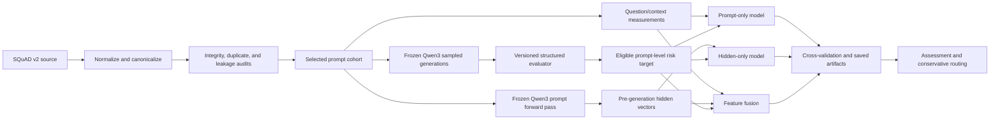
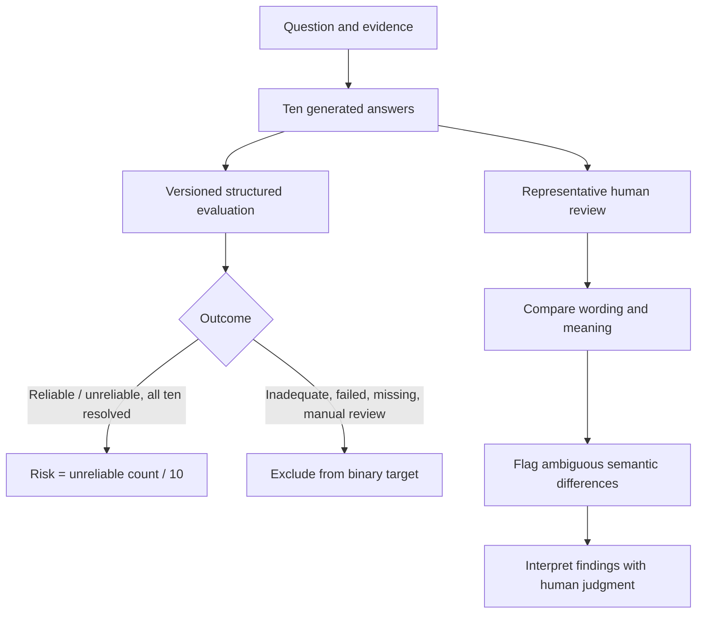
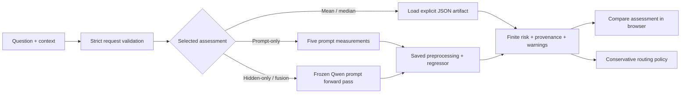

# LUX — Pre-Generation Hallucination Risk Analysis

**Prepared for academic submission · 30 October 2026**

### Project team

| Student | Registration number |
|---|---|
| Anish Mukul Ringe | 23BDS0082 |
| Meet Dinesh Patil | 23BDS0083 |
| Abhigyan Prakash Tiwari | 23BDS0119 |

---

## 1. Project objective and completed scope

We investigated whether information available before answer generation can estimate the likelihood that a language model will produce an unreliable response. We compared three input views: measurable properties of a question and its supplied context, the frozen target model’s hidden representation of the prompt, and a combination of both. We kept answer text and evaluation outcomes outside the predictor inputs so the risk estimate would not depend on information that only exists after generation.

We built the work in stages. We standardized and audited the SQuAD v2 prompt data, checked that Qwen3-1.7B could run in the available local environment, examined generation diversity, froze a repeatable decoding protocol, generated a versioned cohort, evaluated outputs, constructed prompt-level risk targets, and compared predictor families. We then added a conservative inference contract, saved baseline artifacts, and a browser-accessible research interface that can compare prompt-only, hidden-only, fusion, and reference baseline assessments.

The primary expanded research snapshot contains 500 selected prompts and 5,000 generation records. Strict target eligibility yields 486 prompt-level observations for the saved cross-validation analysis. We report the 31-prompt cohort separately when discussing its fully resolved CP4.7.0 evaluation results; these cohorts answer different stages of the study and their numbers are not combined.

### Research question

> Can prompt-level measurements and a target model’s pre-generation hidden representation estimate the fraction of repeated answers judged unreliable for the same prompt?

### What we completed

- Canonical SQuAD v2 prompt scenarios and integrity checks.
- Frozen Qwen3-1.7B CPU generation and pre-generation representation workflows.
- Sampling, decoding, and representative-answer diversity studies.
- A 500-prompt, ten-seed expanded generation cohort and version-isolated evaluation workflow.
- Strict prompt-level risk targets and prompt-only, hidden-only, and fused model comparisons.
- Human qualitative review of answer diversity and potential semantic differences.
- Versioned baseline inference artifacts, CLI, and an interactive assessment interface.

---

## 2. System architecture and end-to-end workflow

The pipeline separates prompt-time features, pre-generation model representations, answer generation, evaluation, target construction, and predictor fitting. That separation lets us train against observed repeated-generation outcomes while restricting prediction-time inputs to information available before the answer exists.

**How the architecture works.** Canonicalization gives each question/context scenario a stable schema and identifier. The frozen target model processes a rendered prompt before generation; the saved representation is kept distinct from sampled answer records. Repeated answer records go through a separately versioned evaluator. Only complete, eligible groups become the empirical target. A shared prompt-level split supports fair comparisons among prompt, hidden, and fused feature sets. The inference layer reads explicit artifacts and validates request/model configuration before returning an assessment.

The diagram represents two related inference paths. Research model artifacts can use saved prompt features, and hidden/fusion assessments can run a frozen Qwen forward pass. The baseline contract is deliberately lighter: it validates the same model and configuration binding but returns a documented cohort constant without loading Qwen or generating an answer.

---

## 3. Dataset design and integrity

We adopted SQuAD v2 because it contains both answerable questions and questions whose answers are absent from the supplied passage. The canonical training artifact contains 130,319 normalized scenarios: 86,821 answerable and 43,498 unanswerable. A stable schema records the question, context, source identity, and answerability/reference information needed by the experimental workflow.

The dataset adapter maps raw source examples to canonical scenarios. Manifest and audit code checks identifiers, required fields, duplicates, structural validity, and leakage-related fields. For expanded-cohort selection, we preserved the initial 31 compatible prompts and sampled additional unique question/context pairs deterministically. We normalized text using Unicode NFKC, case folding, and whitespace collapsing for duplicate detection; 100 duplicate-content rows were excluded from the sampling pool. The resulting cohort contains 500 unique selected prompts.

Each selected prompt was paired with ten fixed seeds (1001–1010). The intended empirical target for a prompt is the number of unreliable judgments divided by ten. Strict eligibility requires ten successful binary judgments from the matching evaluator and prompt version. Inadequate, failed, manual-review, missing, or version-mismatched outcomes do not enter the binary denominator. This prevents a partial set of generations from appearing comparable to a complete ten-sample group.

We maintained evaluator-version isolation in separate directories. The CP4.7.0 results for the initial 310 generations remain distinct from earlier Gemini versions. The expanded cohort reuses compatible prior records and stores new generations separately. This provenance discipline makes it possible to identify exactly which target model, evaluator, prompt instructions, and generation records produced each reported target.

---

## 4. Frozen target model and generation protocol

We used Qwen/Qwen3-1.7B at revision `70d244cc86ccca08cf5af4e1e306ecf908b1ad5e`. We kept the model frozen in evaluation mode and disabled thinking through the Qwen chat template. We ran the main generation protocol on CPU because the available GPU memory and CPU-only PyTorch build did not support loading the model for CUDA execution. The recorded configuration uses sampling, temperature 0.7, top-p 0.8, top-k 20, and a 512-token maximum; seeds 1001–1010 vary across the ten outputs for each prompt.

Before scaling, we completed a six-prompt pilot with 60/60 successful generations and verified same-seed repeatability on six selected cases. We then instrumented decoding to check that the configured temperature, top-k, and top-p transformations matched the model generation scores. Controlled top-p and temperature experiments showed that changing sampling breadth could change surface forms while leaving answers semantically similar in the tested example. These measurements helped us retain an explicit and reproducible generation configuration for the main cohort.

For each selected prompt, the generator stores an ID, seed, prompt and answer text, model revision, decoding settings, status, and runtime metadata. A resumable runner checkpoints progress and keeps generation records available for later evaluation. Separate pre-generation capture stores the target model’s hidden representation from the prompt forward pass. The representation extraction path records vectors across the model’s 29 layer/embedding entries, each with width 2,048; the trained analysis pools hidden features and applies fold-specific preprocessing where specified.

This workflow gives us an empirical set of repeated outcomes under a fixed model and decoding setup. It makes the target interpretable as a cohort- and protocol-specific observed rate, rather than a universal probability that applies to every model or deployment.

---

## 5. Evaluation design and human assessment

### Structured evaluation

We used a versioned structured evaluator to review each generated answer against its question and supplied evidence, returning RELIABLE, UNRELIABLE, or INADEQUATE. CP4.7.0 used `gemini-3.5-flash-lite` with a fixed prompt version and structured schema. For the completed 31-prompt cohort, all 310 generation IDs resolved: 248 RELIABLE, 61 UNRELIABLE, and one INADEQUATE. The inadequate record remained outside the binary risk target, leaving 30 complete ten-answer prompt groups.

For each eligible prompt, we computed unreliable count divided by ten. The 30 targets had mean 0.2033 and ranged from 0.0 to 1.0; 22 prompts had zero observed unreliable answers. For the expanded 500-prompt snapshot, a strict CP4.7.0 snapshot yielded 486 eligible prompt targets for the saved model-selection analysis. These labels are model-based judgments, so we interpret the target as evaluator-derived unreliability rather than independently certified factual correctness.

### Human evaluation and qualitative adjudication

We also used human review in the experimental protocol. We examined representative answer sets for material changes in wording and meaning, especially where the same prompt produced different responses across seeds or decoding conditions. Our six-class conservative comparison distinguished surface-level wording variation from potentially different semantic content. In representative validation, the reviewers flagged potential semantic diversity for human adjudication rather than treating the automated diversity category as a definitive correctness decision. We also inspected cases where an unanswerable prompt received a confident, passage-fluent response and treated those cases as requiring human judgment.

This human review served as a qualitative check on what repeated generations meant and whether variation was merely orthographic or potentially semantic. It informed interpretation of the protocol and exposed ambiguity that simple string-level diversity counts could miss. The large-scale 5,000-generation target labels, however, were created using the frozen versioned evaluator protocol, not a documented full-cohort annotation by human annotators. We keep these two roles distinct: people assessed representative semantic variation and ambiguity; the structured evaluator supplied scalable labels for cohort-level quantitative analysis.

The diagram shows why human assessment matters even when an automated judge provides scalable labels: semantic interpretation supports careful analysis of the answer variations, while only complete version-matched binary records contribute to the numeric target.

---

## 6. Predictive features and model comparison

We compared three feature views. **Prompt-only** models use five measurements derived from the question and context. These capture observable properties without running the target model. **Hidden-only** models use the frozen model’s pre-generation representation, intended to capture prompt-processing signals in the target network. **Fusion** models combine the prompt measurements with a compressed hidden representation. Generated answers, evaluator outputs, target labels, and post-generation fields do not form predictor inputs.

For the expanded 486-prompt analysis, we used saved out-of-fold predictions across five prompt-level folds. Each prompt appears in held-out predictions exactly once, and the saved analysis checks ID alignment, fold disjointness, finite metrics, and paired comparisons against mean and median reference baselines. The saved analysis covers 39 configurations; we interpret the results with the saved model-selection and provenance documentation in view.

The most decision-relevant result under absolute error is the median baseline MAE of 0.2086, compared with 0.2142 for the best saved learned model, prompt-only SVR. The cohort mean baseline MAE is 0.3171. Hidden-only SVR reached MAE 0.2240; fusion SVR reached 0.2240. Some tree-based hidden/fusion configurations showed lower RMSE or slightly positive R², while their MAE remained above the median baseline. The zero-heavy target distribution explains why a constant median of zero is difficult to beat on MAE: 367 of 486 targets were zero.

The comparison therefore supports a measured result: pre-generation features were successfully assembled and tested across model families, but the selected learned predictors did not establish reliable prompt-level risk improvement over a simple median reference on the saved evaluation. We retain the model comparisons as research evidence rather than presenting the learned score as a validated accuracy estimate.

| Saved out-of-fold comparison | MAE | RMSE | R² |
|---|---:|---:|---:|
| Cohort mean baseline | 0.3171 | 0.3869 | -0.0007 |
| Cohort median baseline | 0.2086 | 0.4395 | -0.2910 |
| Prompt-only SVR | 0.2142 | 0.4350 | -0.2646 |
| Hidden-only SVR | 0.2240 | 0.4222 | -0.1915 |
| Fusion SVR | 0.2240 | 0.4222 | -0.1916 |

---

## 7. Evaluation workflow and statistical interpretation

We built dedicated evaluation runners for versioned prompts, structured schemas, retries, resumability, and record-level provenance. The runner reads the stored prompt and answer for each generation, sends the evidence to the configured evaluator, validates the structured response, and persists the outcome with the evaluator and prompt versions. Retry history is retained, quota and transient failures are classified, and secrets are not written to result artifacts.

Target construction joins evaluation records to generation IDs and groups them by canonical prompt identity. A prompt target is computed only after ten version-matched binary outcomes have succeeded. That rule creates comparable denominators across prompts and keeps inadequate or unresolved records visible without converting them to reliable labels. Historical evaluator versions remain separate so changes in model availability or label behavior do not silently alter the primary targets.

We used mean absolute error (MAE) to measure average absolute distance between predicted and observed prompt risk; root mean squared error (RMSE) to emphasize larger misses; and R² to compare predictions with a constant reference under squared error. Paired bootstrap intervals summarize uncertainty in aggregate MAE differences for the saved OOF analysis. The 486 targets have a mean of 0.2086, median 0, and 367 zero values (75.5%). This concentration makes absolute-error evaluation favor a zero predictor and makes prompt ranking and calibration especially important for any later deployment-oriented claim.

Our human review complements these statistics by checking representative outputs where semantic categories may be difficult to automate. It does not convert the model-based cohort labels into a human-annotated gold standard. We report both the scale of structured judgment and the scope of direct human interpretation so that each piece of evidence is understood for what it measures.

---

## 8. Inference software, architecture, and interface

We completed a strict Python inference contract for the baseline artifacts. It checks that a request contains either rendered text or exactly a question/context pair, validates the supported Qwen revision and generation configuration, loads an explicit JSON artifact, verifies its version and SHA-256 provenance, and returns a finite risk value with a structured result. It rejects enriched records containing answer/evaluation fields, so post-generation information cannot enter through the public input schema.

The baseline artifacts contain two cohort constants. The mean artifact returns approximately 0.208642; the median artifact returns 0.0. Both values are marked uncalibrated, carry no individual uncertainty interval, and include warnings that explain their cohort scope. A conservative policy escalates when a score is unavailable or when thresholds are absent. Threshold-based use of an uncalibrated result requires explicit caller opt-in. The interface records predictor identity and pipeline metadata without logging prompt content.

We also built a separate live assessment path using saved prompt-only, hidden-only, and fusion predictors. The FastAPI service validates inputs, uses saved feature transformations and trained artifacts, and can run the frozen Qwen prompt forward pass for hidden/fused selections. It assesses risk before generation and does not produce an answer. The HTML interface lets us select a predictor, submit a question/context, retain assessments in the session, and compare scores after changing the input or predictor. An explicit baseline comparison is available alongside learned methods.

### Component behavior

| Component | Working behavior |
|---|---|
| Request validation | Accepts question/context fields, rejects extra post-generation fields, and reports invalid inputs clearly. |
| Prompt feature path | Computes five input-only features and applies the saved prompt model pipeline. |
| Hidden/fusion path | Renders the prompt, computes pre-generation Qwen hidden states, validates their shape and finite values, and applies saved preprocessing and predictors. |
| Baseline path | Loads the selected mean or median artifact and returns its constant with provenance and warnings. |
| Browser interface | Submits assessments, shows the chosen method and result, retains session comparisons, and presents service errors. |
| Routing policy | Sends unavailable estimates to escalation and requires explicit settings for uncalibrated threshold routing. |

Recorded integration evidence includes successful HTTP responses for prompt-only, hidden-only, fusion, and both explicit baselines on a France/Paris example. The hidden representation had shape 29 × 2,048. These requests demonstrated that the software path executes and returns structured scores; a single diagnostic prompt does not measure predictive accuracy. The current presentation therefore labels learned results as research scores rather than correctness guarantees.

---

## 9. Testing, reproducibility, and engineering quality

We created tests for dataset schemas and manifests, hashing and audit behavior, generation pilots, evaluator schemas and retries, strict target construction, predictor baselines, production pipelines, risk inference, saved-OOF analysis, and live API behavior. The project’s engineering reports record successful focused and regression test runs, including 355 passing tests during baseline inference implementation, 433 passing tests during live-interface integration, and targeted live API runs of up to 12 passing tests. These are recorded development results, not newly executed runs for this report.

The research outputs include versioned JSON manifests, pilot results, per-experiment reports, cross-validation predictions, split assignments, model-selection results, verification summaries, baseline artifacts, and provenance hashes. Generation and evaluation workflows support persisted checkpoints so interrupted runs can resume from saved state. The evaluator records model and prompt versions with every outcome, and strict artifact loading prevents a missing or incompatible baseline from silently becoming an unrelated score.

The repository also contains an interactive app and command-line entry point. The app exposes health and assessment endpoints, rejects malformed requests, and returns sanitized errors for unavailable artifacts or model resources. Integration records show that the API returned HTTP 200 for valid assessment requests and HTTP 422 for invalid questions or predictor choices. The interface does not enable answer generation.

These engineering checks support repeatability of the implemented workflows and integrity of the saved artifacts. The scientific result remains bounded by the SQuAD v2 domain, the frozen Qwen revision and decoding setup, the evaluator-derived target, and the observed cohort. We treat code-path validation and predictive validity as separate forms of evidence.

---

## 10. Conclusion and project learning

We completed an end-to-end research workflow for pre-generation language-model uncertainty analysis. We standardized a large SQuAD v2 prompt source, froze a reproducible generation setup, collected repeated model outputs, created evaluator-derived empirical targets, compared prompt, hidden-state, and fusion predictors, and delivered baseline and interactive assessment software. Architecture diagrams in this report show how the data, models, evaluation, human review, and inference components work together.

The main scientific finding is that the available pre-generation signals did not establish dependable prompt-specific risk prediction on the saved evaluation. The empirical target distribution was dominated by zero-risk groups, and the simple median baseline achieved lower MAE than the best saved learned model. Human review of representative responses helped us distinguish surface wording changes from potentially meaningful semantic variation and identify cases requiring judgment. Large-cohort numerical targets remained tied to the documented structured evaluator protocol.

The project provides a useful, inspectable foundation for further study: reproducible data preparation, explicit evaluator provenance, controlled generation, leakage-aware feature design, model comparison, strict inference inputs, and a working assessment interface. We learned that reliable uncertainty evaluation requires more than a prediction model: the generation protocol, target construction, human interpretation, validation split, and user-facing risk claims all have to align.

**Submitted by:** Anish Mukul Ringe (23BDS0082), Meet Dinesh Patil (23BDS0083), and Abhigyan Prakash Tiwari (23BDS0119).

